<!-- Every card is an animated SVG drawn by scripts/render_cards.py and refreshed daily by
     .github/workflows/update-profile-cards.yml. Keep this block free of blank lines, and keep
     tiles and buttons that share a row on one line with no spaces between them, or GitHub adds gaps. -->

 
 
 
 
 

